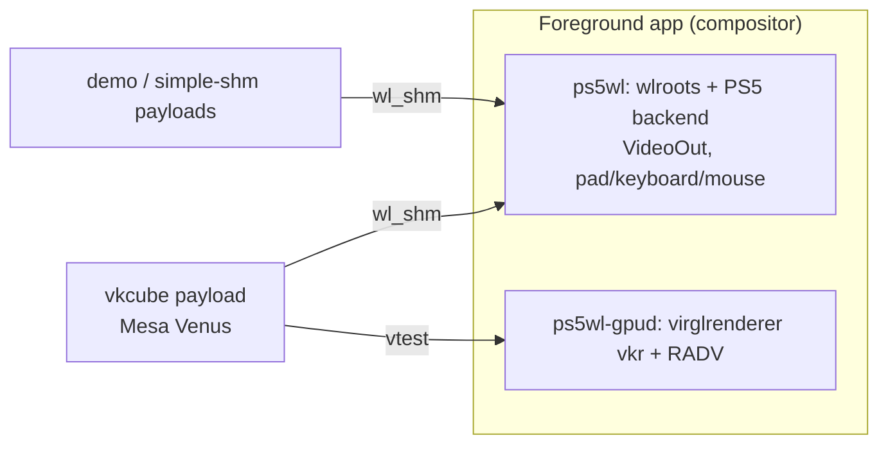

# ps5_wayland

A Wayland compositor that runs on a jailbroken PlayStation 5 as a normal
foreground app, launched from a home-screen icon. Separate client programs
connect to it over `wl_shm`. GPU-accelerated Vulkan clients go through a Venus
GPU server embedded in the compositor.

Status (firmware 10.60):
- **Working on hardware:**
  - the home-screen icon launches the compositor;
  - 1080p60 output;
  - keyboard, mouse and DualSense input;
  - CPU-rendered clients;
  - a separate `vkcube` payload rendering on the PS5 GPU through Venus;
  - lavapipe (CPU Vulkan).
- **Not yet:** GPU composition, audio, LKL integration.



## Requirements

**Build host:**
- Linux with rootless `podman`, `python3` and `git`.
- Everything else (LLVM, meson, the PS5 payload SDK, every library) is pinned
  and built inside a container. Host packages are never used.

**Console:**
- A jailbroken PS5 running [elfldr](https://github.com/ps5-payload-dev/elfldr)
  and [Payload Manager](https://github.com/itsPLK/ps5-payload-manager) (HTTP
  port 8084). Deployment goes through Payload Manager.
- Point the tools at your console with `export PS5_HOST=<ip>`.

## Build

```sh
make ps5-app        # SDK, dependencies, Mesa (RADV + Venus), GPU server, compositor, clients, installer
```

Or step by step. Every step runs inside `env/run`, which builds the container
on first use:

```sh
make sdk            # ps5-payload-sdk v0.44 into .sdk/ (checksum-pinned)
make deps-host      # host tools (wayland-scanner etc.) into build/host/sysroot
make deps-ps5       # libffi, epoll-shim, wayland, pixman, xkbcommon, libdrm, wlroots → build/ps5/sysroot
make mesa-ps5       # PS5 RADV + Venus ICD
make gpud-ps5       # Venus GPU server library
make compositor-ps5 # build/ps5/compositor/ps5wl
make clients-ps5    # ps5wl-demo, ps5wl-simple-shm
make vkcube-ps5     # ps5wl-vkcube-venus
make launcher       # launcher/ps5wl-install.elf (bundles compositor, demo, RADV)
```

Host build, for development and CI without a console:

```sh
make deps-host compositor-host
compositor/tests/smoke.sh
```

## Install and run on the PS5

```sh
tools/ps5ctl run launcher/ps5wl-install.elf     # registers the "PS5 Wayland" icon
tools/ps5ctl logs --port 9580 --retry 30        # installer log
```

1. Select **PS5 Wayland** on the home screen. The compositor starts with the
   interactive demo.
2. To launch the GPU cube into it:

   ```sh
   tools/ps5ctl run build/ps5/vkcube-venus/ps5wl-vkcube-venus.elf
   ```

3. Exit the whole app with **Ctrl+Alt+Backspace**, or by holding **Options +
   Create** on the DualSense. Escape closes only the focused client.

Logs are pulled from the console, since payloads listen on TCP:
- `tools/ps5ctl logs --port 9530` for the compositor;
- `tools/ps5ctl screenshot --port 9531 --output shot.png` for a screenshot.

The resident launcher doesn't survive a reboot. After rebooting and rerunning
the jailbreak, run the installer again (the icon itself persists).

## Layout

| Path | Contents |
|---|---|
| `compositor/` | wlroots-based compositor `ps5wl`; `src/backend/ps5/` is the VideoOut/input backend |
| `gpu-server/` | `ps5wl-gpud`: Venus (virglrenderer vkr) GPU server with vtest and render-protocol front ends |
| `clients/` | Test clients: `demo`, `simple-shm`, and `vkcube` variants (RADV / Venus / lavapipe) |
| `launcher/` | Home-screen installer and foreground-app launcher (hbldr technique), plus the close helper |
| `common/` | `ps5log` (pull-model TCP logger) and the `ps5wl-client` helper |
| `deps/` | Pinned dependency builds (`versions.lock.json`), PS5 patches, the compat shim (`deps/ps5/shim`), Mesa, LLVM |
| `cross/` | PS5 compiler proxy (`cross/bin/prospero-clang`), meson/cmake cross files |
| `env/` | Pinned build container (`env/run`) |
| `toolchain/` | SDK installer and environment |
| `tools/ps5ctl` | Deploy/launch/log/screenshot CLI for Payload Manager |
| `probes/` | Hardware capability probes and their results |
| `docs/PS5-DEV-GUIDE.md` | Getting started on PS5 plus everything we learned about the platform |
| `PLAN.md`, `gpu-server/PLAN.md` | Design decisions and the GPU architecture |

## Notes

- PS5 code must be compiled with `cross/bin/prospero-clang`. It links a shim
  that works around broken `*_CLOEXEC` handling, `F_DUPFD_CLOEXEC` and `ppoll`
  in the console's libc. See `docs/PS5-DEV-GUIDE.md`.
- Running on a console carries real crash risk. Read the safety rules in the
  guide before experimenting.
- Third-party code keeps its own license:
  - `launcher/` includes GPL-3.0 code from elfldr/websrv (`launcher/COPYING`);
  - the compositor is derived from wlroots' tinywl (MIT);
  - `clients/` includes Weston's simple-shm (MIT);
  - parts of the backend follow ps5-payload-dev/SDL (zlib).
