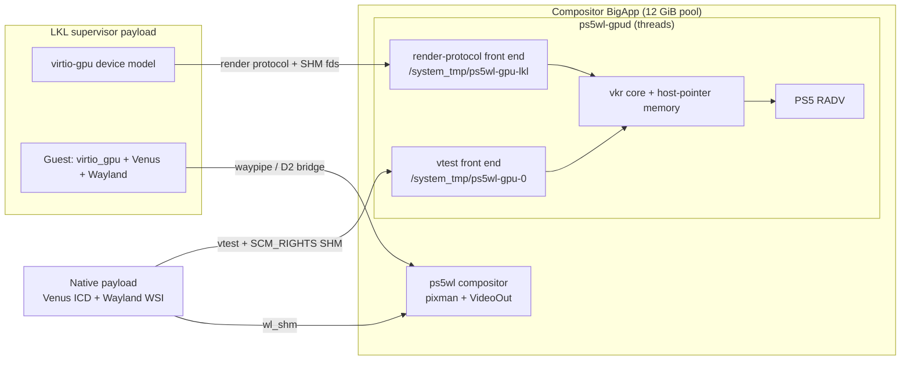

# GPU rendering for separate-binary clients: reviewed plan

Status: proposal for approval, 2026-10-16. Supersedes the "Venus, under
investigation" bullet in `../PLAN.md`. `DESIGN.md` (Venus research notes)
stays as the source review. Labels: **[V]** = checked by reading pinned source
or local evidence, **[HW]** = recorded console result, **[HEARSAY]** = public
claim not reproduced here, **[INFERENCE]** / **[ESTIMATE]** = reasoning or
guesses, **[UNVERIFIED]** = open until a listed experiment settles it.

## 0. Decision summary

The GPU plan has to serve two kinds of client: **native PS5 payload clients**
and **Linux guests running under LKL** (`~/lkl-freebsd`, whose
`IMPLEMENTATION_PLAN.md` §M9 already names Venus as its later GPU route). With
both in scope, the recommendation is:

1. **One GPU server, `ps5wl-gpud`, running inside the compositor's foreground
   BigApp.** It is built on virglrenderer's **vkr** (Venus renderer) and calls it
   directly. It does **not** use virglrenderer's proxy, render-server process or
   vtest server binary. It loads PS5 RADV, the only Vulkan driver that can work
   in that process.
2. **Two front ends over one vkr core:**
   - **vtest front end** for native payloads: an AF_UNIX socket at
     `/system_tmp/ps5wl-gpu-0`. Clients use Mesa's stock Venus ICD
     (`libvulkan_virtio`) over `VTEST_SOCKET_NAME`.
   - **Render-protocol front end** for the LKL supervisor. Its own virtio-gpu
     device model (inside the LKL process) forwards Venus contexts to the
     server. The guest runs a stock Linux `virtio_gpu` kernel driver and the
     stock Venus driver.
3. **Memory without fd export:** host-visible memory is a server-created
   `SHM_ANON` object, imported into RADV with `VK_EXT_external_memory_host` and
   handed to the client as an ordinary SHM fd over SCM_RIGHTS.
4. **Lavapipe** stays an independent CPU fallback for payload clients, needing
   no server.
5. **Rejected:** fork or budget tricks, and app-local processes (crash-level
   risk). **Last resort:** in-app client modules.

Why Venus wins once LKL is in scope:
- An alternative with better performance for native clients exists: a
  *split-RADV broker*, with public prior art (§3b). But a Linux guest cannot use
  it without a guest-side PS5-patched RADV and a new native-context backend.
- Venus gives **both** client kinds a standard, upstream-maintained client
  stack and protocol. The server-side porting cost is paid once.
- The broker is kept as a measured Plan B / optimisation track for native
  clients (§8), not built now.

## 1. Problem and hard constraints

| # | Constraint | Evidence |
|---|---|---|
| H1 | Only the foreground BigApp can allocate GPU direct memory at app scale. It sees a 12 GiB pool, and our compositor is that BigApp. | [HW] `../compositor/src/backend/ps5/README.md:48-61`; `../clients/vkcube/README.md:97-102` |
| H2 | A plain elfldr payload sees the 12 GiB size while the compositor is foreground, yet `AvailableDirectMemorySize` returns `0x8002000c` and an 8,306,688-byte allocation returns `0x80020023` (EWOULDBLOCK, i.e. "no suitable extent"). Small allocations (a 64 KiB test, an earlier 20 MiB full-pool scanout) succeeded. With no foreground app the pool reads 0. | [HW] `clients/vkcube/README.md:90-125`, backend README `:13-17`; error meaning: PS5_Vulkan `jobs/r87-gpu-ceiling/readback.txt` @f410e67 [V] |
| H3 | The cause is not simply `budget_set(0)`: websrv's hbldr, and our `launcher/hbldr.c:414-416`, issue the same `syscall(0x23b, 0)` to the BigApp. The app/dmem context is retained some other way. | [V] elfldr `elfldr.c` L563-595, L623-631 @02cfe91; websrv `hbldr.c` L383-400 @7748df9 |
| H4 | `fork()` inside the BigApp crashed the console (user had to hard power-cycle). Process creation from the app process is crash-level risk. Raw fork in a *plain payload* works. | [HW] backend README `:65-86` + coordinator; `../probes/lkl/RESULTS.md:128-133` |
| H5 | A BigApp exits only through `sceSystemServiceLoadExec("exit")` or LNC kill. Raw `_exit`/SIGKILL leaves it stuck. | [HW] `../launcher/README.md:289-359` |
| H6 | PS5 RADV (pacbrew 722187f0, Mesa 26.2.0) has no external memory, fence or semaphore fds (`buffer_from_fd`/`get_fd` return failure). `VK_EXT_external_memory_host` exists and uses `sceKernelMprotect` GPU bits. `minImportedHostPointerAlignment` is 16 KiB. **Host-pointer import is valid for exactly one memory type** (first cached GTT). | [V] `radv_ps5_bo.c:168-217`, `radv_ps5_platform.c:786-793`, `radv_physical_device.c:2141`, `radv_device.c:65-83` |
| H7 | A title's anonymous memory gains GPU access through `sceKernelMprotect`, and a shader wrote 16 KiB of it. Shared (`SHM_ANON`, `MAP_SHARED`) mappings are **[UNVERIFIED]**. | [HEARSAY→V source] PS5_Vulkan `docs/HARDWARE_FINDINGS.md` L3691-3713 @f410e67 |
| H8 | Proven between payloads: AF_UNIX on `/system_tmp`, SCM_RIGHTS, and 32 MiB `SHM_ANON` coherence. `F_DUPFD_CLOEXEC` and `*_CLOEXEC` are broken, so the shim is mandatory. There is no native eventfd. epoll-shim's emulated eventfd cannot be read through a duplicate or passed to another process. pipe/poll/kqueue work. | [HW] `../probes/RESULTS.md:14-22,97-107,345-378` |
| H9 | PS5 maps memory at 16 KiB granularity. 4 KiB `MAP_FIXED` addresses and offsets fail `EINVAL`. | [HW] `probes/lkl/RESULTS.md:127` |
| H10 | elfldr passes no argv/env, so clients must find the server through compiled defaults (the `common/ps5wl-client` convention). | `../PLAN.md:58`; `common/ps5wl-client/ps5wl-client.c:32-33` |
| H11 | A GPU page fault caused a Shell UI restart in a title. | [HEARSAY] HARDWARE_FINDINGS L11-13 |

Public research summary (agent `Ps5BudgetResearch`):
- No public PS5 work shows a **second independent** GPU/direct-memory owner
  beside a foreground BigApp.
- PS5_Vulkan's gpu-broker reports four DXVK client processes rendering through
  one owner. This is [HEARSAY]: PS5_Mesa `ps5/broker/README.md` @f7ce91ac says
  `payload-graphics-10`, and the PS5_Proton source is not public.
- `sceSystemServiceAddLocalProcess` exists (PS4 writeup, and etaHEN PS5
  spawner). Whether a local child shares the app's dmem is undocumented.

## 2. Review of `DESIGN.md` and the partial code

DESIGN.md is accurate on what it claims. Additional findings from the pinned
sources:

- **R1 – Stock Venus cannot run inside the app process.**
  - Upstream route: `vtest_server.c:301-304` forces `RENDER_SERVER`.
    `proxy_server.c:39-85` then `fork()`s and `execv()`s `virgl_render_server`
    (both forbidden by H4; execve of an unsigned binary also fails EACCES,
    `probes/lkl/RESULTS.md:130`).
  - In 1.2.0, vkr is reachable only through the render server
    (`virglrenderer.c:926-933`, `server/render_state.c:155-156`).
  - `vtest_server.c:490-500` calls `exit(1)` when an accept fails.
  - `vtest_block_read` (`vtest_renderer.c:396`) blocks per command, so one
    stalled client stalls them all.
  - **Fix:** a small front end of our own over the internal
    `vkr_renderer_*` API (`src/venus/vkr_renderer.h:29-75`: init, create/destroy
    context, submit_cmd, submit_fence, create/import/destroy resource). Link
    only the vkr sources (`src/meson.build:63-100`). This also removes the
    libepoxy/vrend build dependency (DESIGN.md §Build).
- **R2 – Timelines need eventfd.** `VCMD_PARAM_MAX_TIMELINE_COUNT` is nonzero
  only `#ifdef HAVE_EVENTFD_H` (`vtest_renderer.c:961-968`). Venus refuses to
  start without it ("no timeline support", `vn_renderer_vtest.c:951-957`).
  Sync-wait fds are eventfds, with `-ENODEV` otherwise (`:2111-2118`).
  - The client only `poll()`s the fd and then closes it
    (`vn_renderer_vtest.c:816-863`), so **one pipe read end per wait** is a
    drop-in replacement (H8).
- **R3 – Memory-type bug in `patches/0002-host-pointer-memory.patch`.**
  - RADV's host-pointer `memoryTypeBits` contains a single type (H6). The patch
    therefore fails *every* allocation in any other host-visible type, and
    returns `VK_ERROR_INVALID_EXTERNAL_HANDLE`, which `vkAllocateMemory` may not
    return.
  - The host lavapipe smoke cannot catch this: lavapipe exposes one memory type
    (`lvp_device.c:1763`).
  - **Fix:** in vkr's memory-properties reply, advertise `HOST_VISIBLE` only on
    importable types. Other types become device-local-only, so clients never
    request an impossible import.
- **R4 – `smoke.py` tests the wrong topology.** It sets
  `RENDER_SERVER_EXEC_PATH`, i.e. the fork/exec render server. It cannot stand
  in for the PS5 design.
- **R5 – Flexible memory.** Every host-visible byte becomes SHM mapped in the
  BigApp. The app's flexible/SHM accounting limit is **[UNVERIFIED]**
  (experiment C1).
- **R6 – Two prerequisites are unproven in our hbldr BigApp:** RADV `dlopen`
  and `sceAgcInit` inside it. PS5_Vulkan reports that native titles cannot
  `dlopen` driver `.so` files and link RADV statically. Our compositor is a
  payload-SDK ELF injected by hbldr, a different runtime [UNVERIFIED].
  **Fallback:** link RADV statically into the compositor.
- **Disposition of the partial code:** move `build.py`, `smoke.py`, `patches/`
  and `mesa-patches/` under `gpu-server/venus-research/` unchanged. Delete them
  once G2 lands. The lavapipe fd-masking patch remains useful for host tests.

## 3. Candidates compared (native payloads *and* LKL guests)

| Option | Native payload clients | LKL Linux guests | Isolation | Perf [ESTIMATE] | Effort [ESTIMATE] | Main risk |
|---|---|---|---|---|---|---|
| **a. Venus/vkr server in app (recommended)** | Stock Venus ICD over vtest; no client direct memory | Stock guest `virtio_gpu` + Venus over an LKL virtio-gpu device → same vkr core | API boundary. Client CPU crashes stay in the client. Invalid Vulkan usage can crash RADV inside the compositor. A GPU hang affects everything. | GPU-bound ≈ native; CPU per-call encode/decode; shader compiles on server threads | 5–7 weeks for both front ends | H7 shared-SHM GPU access; flexible-memory limit; RADV in BigApp |
| b. Split-RADV broker (PS5_Vulkan gpu-broker style) | Client runs full RADV (ACO, command recording); owner only allocates, submits on its AGC ring and fences; host-visible SHM at identical VAs | Needs a guest Linux RADV carrying the PS5 patches plus a virtio "native context" winsys, and a new owner nctx backend: large and off-upstream | Trusted clients only: client PM4 runs with owner GPU privileges. Owner code is small. | ≈ native; one RPC per submit ("tens of µs" [HEARSAY] `client.c:55-57`) | 2–3 weeks native-only | Overlay port onto our pin; trusted PM4 |
| b2. gfxstream / custom command stream | Possible | gfxstream has a guest driver; host is C++ AEMU + virtio-gpu, larger than vkr; a custom stream serves no stock apps | — | — | Large | Not justified |
| b3. virgl (GL) over vtest | GL clients via zink→RADV in the server | Same, via virtio-gpu | — | — | Add-on later | Zink on Venus client-side covers GL anyway [INFERENCE] |
| c. Give clients app budget | Would allow native RADV per client | n/a | Best | Native | Unknown | No public evidence. `budget_set` guessing has a documented panic hazard (websrv `hbldr.c` L390-395). `AddLocalProcess` means process creation from or for the app (H4 class). Research-only spike, with explicit approval. |
| d. Client ELFs as modules in the compositor | Native RADV, no copies | n/a | None: a client crash or `exit` kills the compositor | Native | 1–2 weeks | Violates "separate binaries" in spirit |
| e. Lavapipe in each payload | CPU Vulkan, wl_shm (upstream sw path); needs LLVM JIT: anonymous RW→RX and RWX already pass in payloads (`probes/lkl/RESULTS.md:115-116`); LLVM ≥ 8 suffices for MCJIT on x86_64 (`mesa meson.build:2045-2050`); pacbrew has a PS5 LLVM 14.0.6 recipe | Guest's own llvmpipe (the LKL M-D2 baseline) | Full process isolation | 2D/light 3D only | 1–1.5 weeks | LLVM cross build |
| f. Payload RADV on its own flexible memory | If payloads can GPU-map their anonymous memory and submit (they can submit: [HW] vktest), no server is needed | n/a | Separate GPU contexts [INFERENCE] | Native | 1 week if C2a passes | Untested; may need direct memory for rings |

## 4. Recommended architecture



### 4.1 Components, layout, ownership

```
gpu-server/
  PLAN.md  DESIGN.md
  core/       vkr build (vkr sources only, our meson), memory patches, fence/timeline glue
  vtest/      our vtest front end (protocol v4 subset Venus uses), per-client threads
  render/     render-protocol front end for LKL (server/render_protocol.h messages)
  include/ps5wl_gpud.h   compositor-facing API
  tests/      host tests (env/run): lavapipe with PS5WL_NO_EXTERNAL_FD as RADV stand-in
  probes/     console probes C1/C2
  venus-research/        frozen partial code from DESIGN.md
deps/mesa/    + Venus ICD variant for PS5 payloads (Ps5Deps): exported vk* entrypoints
              as patch 0021 does for RADV; built-in default VTEST_SOCKET_NAME
compositor/   start/stop call sites only (Ps5Backend)
common/ps5wl-client   sets VTEST_SOCKET_NAME default (Clients)
~/lkl-freebsd host/   virtio-gpu device model + renderer client (LKL owner)
```

Compositor API, called from `main` before backend init:
```c
struct ps5wl_gpud_config { const char *vtest_path, *render_path;
  uint64_t host_bytes_per_ctx, device_bytes_per_ctx; unsigned max_ctx; };
int  ps5wl_gpud_start(const struct ps5wl_gpud_config *);  /* loads RADV, vkr_renderer_init */
int  ps5wl_gpud_stop(unsigned drain_ms);                  /* 0 drained, -EBUSY wedged */
```

### 4.2 Memory contract

- **Server-side allocation:** for every host-visible `vkAllocateMemory`, the
  server
  1. creates `SHM_ANON`;
  2. maps it 16 KiB-aligned;
  3. imports it through `VkImportMemoryHostPointerInfoEXT` (RADV mprotects the
     pages for GPU access);
  4. returns a duplicate of the SHM fd as a `VIRGL_RESOURCE_FD_SHM` blob.

  Sizes are rounded up to 16 KiB.
- **Memory-type masking:** only the importable types are advertised as
  host-visible (R3).
- **Device-local memory:** RADV allocates it from the app's direct pool
  normally. It is never exported.
- **Ring and reply memory:** Venus's blob-id-0 rings already use
  `os_create_anonymous_file` → `SHM_ANON` on FreeBSD
  (`src/mesa/util/anon_file.c:125-126`, `vkr_context.c:283`).
- **Quotas per context:** host bytes, device bytes and object count. Exceeding
  a quota returns `VK_ERROR_OUT_OF_*_MEMORY`, never an abort.
- **Coherence:** PS5 direct memory is cached and coherent both ways
  [HEARSAY HARDWARE_FINDINGS]. For imported SHM this is **[UNVERIFIED]** (C2a).

### 4.3 Native front end (vtest)

- **Commands** (exactly those Mesa 26.2 Venus sends):
  - CREATE_RENDERER, PING_PROTOCOL_VERSION, RESOURCE_BUSY_WAIT (dummy),
    PROTOCOL_VERSION=4
  - GET_PARAM (MAX_TIMELINE_COUNT, HOST_COHERENT_DMABUF_BLOB=0), GET_CAPSET
    (Venus), CONTEXT_INIT
  - RESOURCE_CREATE_BLOB (HOST3D, reply carries an fd), RESOURCE_UNREF
  - SYNC_CREATE/UNREF/READ/WRITE/WAIT (reply carries a pipe fd)
  - SUBMIT_CMD2 with ring index

  Source: `vn_renderer_vtest.c:160-860`. Anything else disconnects the client.
- **Threads:** one per connection. A malformed or stalled client blocks only its
  own thread. vkr's ring, queue and monitor threads run per context as upstream.
- **Timelines:** syncs are signalled from vkr's `retire_fence` callback. Each
  wait gets a fresh `pipe()`; the write end receives one byte when the wait is
  satisfied or times out.
- **Discovery:** the compiled default is `/system_tmp/ps5wl-gpu-0`, overridable
  with `VTEST_SOCKET_NAME`, which `ps5wl_client_init()` sets (H10).
- **Identity:** `LOCAL_PEERCRED` works but its uid is unreliable (H8). Clients
  are trusted, and their logged pid comes from CREATE_RENDERER's name.
- **Presentation:** with no dma-buf, Venus initialises WSI as a software device
  (`vn_wsi.c:134-185`). The swapchain is a linear image in host-visible blob
  memory; the client copies it into its own `wl_shm` buffer. That is one GPU
  write plus one client memcpy per frame, plus the compositor's pixman and tile
  copies.
  - **Later zero-copy:** since the blob pages are already in the compositor
    process, the client could present by resource id through a private
    `ps5wl_gpu_buffer_v1` Wayland protocol (G6).

### 4.4 LKL front end and device model

The guest side is fully stock:
- Linux 6.12 `CONFIG_DRM_VIRTIO_GPU` with features `RESOURCE_BLOB`,
  `CONTEXT_INIT` and the host-visible shm region;
- Ubuntu's `mesa-vulkan-drivers` Venus ICD over `/dev/dri/renderD128`.

| Piece | Required work | Evidence |
|---|---|---|
| virtio-mmio shm region | The guest supports `SHM_SEL/LEN/BASE` (`vendor/lkl/drivers/virtio/virtio_mmio.c:536-578`). The LKL host library `tools/lkl/lib/virtio.c:364-497` implements none of them. Add those registers and a guest-physical window for the host-visible region. | [V] |
| virtio-gpu device | New `host/.../virtio_gpu.c` on LKL's virtio library. Control queue handles GET_CAPSET(_INFO), CTX_CREATE (capset Venus), SUBMIT_3D, RESOURCE_CREATE_BLOB, MAP_BLOB/UNMAP_BLOB, and fences with ring idx. Each is forwarded over `/system_tmp/ps5wl-gpu-lkl` using the render protocol (`server/render_protocol.h`, 1.2.0). | [INFERENCE] design |
| Blob mapping | MAP_BLOB places the server's SHM fd at an offset in the host-visible window. Guest `mmap` of the blob is a `VM_PFNMAP` onto those "device" PFNs. The LKL canonical mapping entry (`IMPLEMENTATION_PLAN.md` M-D2) currently **rejects device PFNs**: it needs a second admitted class, "virtio-gpu window PFN → (SHM fd, offset)". The worker then maps that fd `MAP_SHARED`. The fd chain is server → supervisor → worker over SCM_RIGHTS. | [V] plan text; [INFERENCE] fix |
| 16 KiB vs 4 KiB | The server rounds blobs to 16 KiB. The guest allocates window offsets with `drm_mm_insert_node` at PAGE_SIZE alignment (`virtgpu_vram.c:153`); a small LKL patch makes that 16 KiB alignment. This keeps every blob 16 KiB-aligned in the window, so worker aliases never need 4 KiB `MAP_FIXED` (H9). Ordinary guest RAM keeps LKL's own projection rules. | [V] source line; [INFERENCE] fix |
| Fences | The render protocol reports timeline seqnos in a shmem page, with an optional eventfd (`render_protocol.h:119-130`). We send **no eventfd**. The device model polls the shmem seqnos from its virtio thread, or receives a pipe byte, and completes virtio fences. | [V] |
| Presentation | Guest Wayland renders with Venus into blob memory. **D1:** waypipe in the guest to `/system_tmp/wayland-0` via the supervisor bridge (copies). **D2:** the supervisor already holds the blob's SHM fd, so a Wayland bridge can forward the *server* SHM fd as the `wl_shm` pool: zero guest-side copy. | `../PLAN.md` M7 |
| LKL process | The supervisor is a plain payload; no GPU or direct memory is needed there (H2 is irrelevant to it). | [INFERENCE] |

### 4.5 Lifecycle and teardown

| Event | Behaviour |
|---|---|
| Start | `ps5wl_gpud_start` runs before the Wayland socket opens. If RADV fails, front ends still listen and answer CREATE_RENDERER with an error; the compositor continues on pixman. |
| Client exit or crash | Socket EOF → `vkr_renderer_destroy_context` (device idle wait bounded to 2 s) → unmap/close SHM, free device memory. A client's still-mapped SHM pages stay valid for that client. |
| Compositor shutdown | Stop accepting → shut down all client sockets (Venus watchdog → DEVICE_LOST) → destroy contexts with a 5 s drain → unload. Then backend teardown and `LoadExec("exit")` (H5). |
| GPU wedged (fence stalled > 5 s or submit error) | Mark wedged: refuse new contexts and submits, keep all memory mapped, keep compositing on pixman, log `gpud wedged`. Recovery after a GPU hang is **[UNVERIFIED]**; never provoked deliberately. |
| LKL supervisor dies | Same as a client EOF for every context it owned. |

### 4.6 Failure isolation

| Failure | Contained? |
|---|---|
| Client CPU crash or exit | Yes (separate process) |
| Malformed protocol | Yes: vkr's decoder marks the context fatal. Our front end bounds lengths and disconnects. |
| Invalid but well-formed Vulkan usage | **No.** It may crash RADV inside the compositor; vkr does not validate VUIDs. Clients are trusted. `-Dvenus-validate` is only for debugging. |
| Memory exhaustion | Yes: per-context quotas |
| GPU hang or page fault | **No:** console-wide (H11). Only the wedged mode applies. |
| Fork in the app | Never done |

### 4.7 Performance expectations [ESTIMATE]

- One 1080p swapchain client costs about 4 × 8.3 MB of blob memory plus 2 MiB
  of rings.
- Each frame costs one client memcpy and two compositor passes over 8.3 MB,
  about 1.5 GB/s at 60 fps (roughly one Zen 2 core).
- GPU-bound work runs near native. Draw-call-heavy clients pay Venus
  encoding/decoding costs.
- Measure in G4; the zero-copy presentation in G6 removes the client copy.

## 5. Milestones and acceptance (host first)

| ID | Deliverable | Acceptance test |
|---|---|---|
| G0 | Approval; partial code frozen under `venus-research/` | User OK on this plan |
| G1 host | `core/` + `vtest/` built in `env/run`: vkr-only build without epoxy, pipe-based waits, host-pointer memory with type masking. Host RADV stand-in is lavapipe with `PS5WL_NO_EXTERNAL_FD=true`. Masking is also unit-tested against a fake second memory type. | `gpu-server/tests/vtest-cube`: headless ps5wl plus `ps5wl-gpud` *as a thread in a test host process* (no render server, no fork). Venus vkcube presents 120 frames over wl_shm; server log shows `host-pointer blob` and zero fd-export calls. ASan/UBSan clean. Killing the client mid-run releases all SHM (fd and mapping counts return to baseline). Two concurrent clients pass. |
| G2 PS5 build | ps5wl links the gpud with RADV (shared through dlopen, or static fallback); Venus ICD payload variant `/data/ps5wl/libvulkan-venus.so.1`; vkcube and vktest built against it | Clean builds through `cross/bin` |
| C-series | Console experiments (§6) | Per §6 |
| G3 | Venus vktest from a payload to the compositor (C3) | `mismatches=0 RESULT PASS`; compositor clean `LoadExec` exit |
| G4 | Venus vkcube 1080p over Wayland (C4): fulfils `../PLAN.md` M6 | 600 presents; screenshot (port 9531) shows the cube; kill + relaunch works; compositor survives |
| G5 LKL | Virtio-gpu device + render front end; host test in the LKL FreeBSD VM using lavapipe as the server driver; then the console | Guest `vulkaninfo` lists the Venus device; guest vkcube offscreen readback is correct; guest Weston/waypipe frame reaches ps5wl |
| G6 | Zero-copy presentation (`ps5wl_gpu_buffer_v1`, and the D2 SHM-fd bridge) | ≥ 30 % compositor CPU reduction at 1080p60 versus G4 |
| L track | Lavapipe PS5 payload (LLVM cross build, JIT) | vkcube on lavapipe presents 600 frames on the console |

Current hardware acceptance: G3, G4/C4 and L-track L5 passed on PS5; see
[`probes/RESULTS.md`](probes/RESULTS.md), final recovered-console section.
The refreshed no-timeout, PowerTick/getter-only app is installed, passed its
normal icon-handler/demo/Venus/shipping-close preflight, and is left not
running. G5/G6 are separate future milestones, not required for this native
interactive Vulkan-app handoff and not claimed by that evidence.


## 6. Console experiment ladder (strict order; stop at any unexpected result)

| # | Context | What | Hang risk | Containment |
|---|---|---|---|---|
| C1 | Plain payload, then BigApp diagnostic (`launcher/test.sh --elf`, 30 s) | No GPU work. Measure: `SHM_ANON` + `MAP_SHARED` at 16 KiB, then `sceKernelMprotect(GPU RW)` return code; `sceKernelAvailableFlexibleMemorySize` before and after mapping 64/256/1024 MiB SHM; direct-memory ladder (2 MiB steps to 256 MiB, type 12, plus SDL-style `AllocateMainDirectMemory` type 3), all released; RADV `dlopen` + `vkCreateInstance` only (BigApp) | Low | Bounded timer, `LoadExec`, `ps5wl-close.elf` ready |
| C2a | Plain payload, compositor foreground | vktest variant: import a `SHM_ANON` `MAP_SHARED` page set (16 KiB, 8 MiB, 64 MiB) with external_memory_host, fill on the GPU, fence with 2 s timeout, read back; a second payload maps the same SHM and verifies (cross-process). Optional option-f probe: all RADV BOs on flexible memory | Low–moderate (GPU fault → Shell UI restart) | One size at a time; abort on first mismatch |
| C2b | BigApp diagnostic | gpud selftest: RADV device inside the compositor, clear plus readback into an imported SHM page; no VideoOut | Moderate | 2 s fence timeout → wedged → `LoadExec` |
| C3 | Compositor (`PS5WL_TEST_SECONDS=60`) + payload | G3 | Moderate | Same |
| C4 | Interactive | G4; then killing the client mid-frame | Moderate | Kill only receipt-owned payloads |
| C5 | LKL payload + compositor | G5 | Moderate | LKL's own bounded runner |
| ✗ | — | fork/rfork in the BigApp, `budget_set` variants, AddLocalProcess | Crash-level | Only with the user's explicit approval as a separate spike |

Decision gates:
- **C1 fails on SHM mprotect in the BigApp:** fall back to private anonymous
  imports with a server-side memcpy to SHM on map/unmap (slow), and reconsider
  §8.
- **C1 flexible headroom below 1 GiB:** lower per-context host quotas; report
  to the user.
- **C2b RADV dlopen fails:** link statically.
- **C2a option-f passes fully:** offer the user native-RADV payload clients
  (option f) as an *additional* fast path for native clients. LKL still needs
  Venus.

## 7. Open questions and resolution

| Q | Question | Resolved by |
|---|---|---|
| 1 | GPU access to shared `SHM_ANON` mappings in the BigApp (H7) | C1 + C2b |
| 2 | Cross-process coherence of GPU-written SHM | C2a |
| 3 | App flexible-memory / SHM limit | C1 |
| 4 | RADV `dlopen` + `sceAgcInit` in the hbldr BigApp | C1/C2b |
| 5 | vkr 1.2.0 ↔ Mesa 26.2 Venus protocol compatibility (renderer headers pin Vulkan 1.4.307, DESIGN.md) | G1 host |
| 6 | Extensions vkr does not pass through (`vkr_extension_get_spec_version` allow-list) | G1: log the list against RADV's |
| 7 | AF_UNIX `SOCK_SEQPACKET` on PS5. The render protocol requires it (`render_socket.c:31,47`). | C1 adds a socketpair check. Fallback: framed SOCK_STREAM in our own render front end. |
| 8 | LKL virtio shm-region and device-PFN mapping class | LKL owner design review, then G5 host |
| 9 | GPU hang recovery | Not tested deliberately; wedged mode |
| 10 | Venus ICD needs exported `vk*` symbols for the pacbrew no-loader model | G2 patch, mirroring pacbrew 0021 |
| 11 | Licensing: virglrenderer is MIT; reusing broker code would add LGPL-2.1 | Only if §8 is chosen |

## 8. Plan B: split-RADV broker for native clients

Trigger: Venus cost at G4 is unacceptable for native clients, or vkr cannot
drive PS5 RADV.
- **Prior art:** PS5_Vulkan `tooling/gpu-broker/` @f410e67 (protocol.h,
  client.c, server.cpp) and PS5_Mesa `ps5/broker/*.patch` @f7ce91ac.
- **Fit with our RADV:** the client implements exactly the
  `radv_ps5_platform.h` API our pinned RADV uses (alloc/free/submit/tess/offchip
  [V]). It lacks `radv_ps5_memory_error`. RADV's PS5 command stream already
  appends its own completion marker (`radv_ps5_cs.c:325-331,657`).
- **Owner:** allocates SHM at identical VAs (`0x240000000`+512 MiB,
  `0x3000000000`+16 GiB), copies each stream into staging, submits through
  `sceAgcDriverSubmitDcb` and tracks fences (`server.cpp:339-472`).
- **Host testing:** possible with the RADV PS5 host model, where submissions
  complete at once (`radv_ps5_platform.c:1007-1016`).
- **Limits:** trusted PM4 and native clients only. It would run **alongside**
  Venus (LKL keeps Venus).

## 9. Sources (pinned)

Local trees:
- virglrenderer 1.2.0 (`.cache/deps/virglrenderer-1.2.0.tar.bz2`, extracted
  unmodified for citations).
- Mesa 26.2.0 + pacbrew 722187f0 (`build/mesa/sources/`).
- `~/lkl-freebsd/vendor/lkl` (Linux 6.12) and its `IMPLEMENTATION_PLAN.md`
  §M9/M-D2.

Public sources:
- https://github.com/mihawk-99/PS5_Vulkan/tree/f410e67a0241b3e8edcdbcd2a9b285dfc4a412ed
  (`docs/HARDWARE_FINDINGS.md`, `tooling/gpu-broker/`, `jobs/r87-gpu-ceiling/`)
- https://github.com/mihawk-99/PS5_Mesa/tree/f7ce91ac4c3697990bf89d79fdc61ae7cb98570b/ps5/broker
- https://github.com/ps5-payload-dev/websrv/blob/7748df9d2a43822a5ebfda149f43d4f2696d640b/src/ps5/hbldr.c
- https://github.com/ps5-payload-dev/elfldr/blob/02cfe91eb3f9697787460ad77d73ff951f801f50/elfldr.c
- https://github.com/ps5-payload-dev/SDL/blob/ee4c47dc0d617b3bc8f35108f9956baf228a1322/src/video/ps5/SDL_ps5video.c#L188-L240
- https://github.com/etaHEN/etaHEN/blob/dafa13b562ddb137a4b4a97b9aaa287c0c57cc9c/Source%20Code/libhijacker/source/spawner.cpp
- https://github.com/LightningMods/PS4-daemon-writeup/blob/dc040caac0cc0c8063f577a40996e929b3b738552/writeup.md#L271-L314
